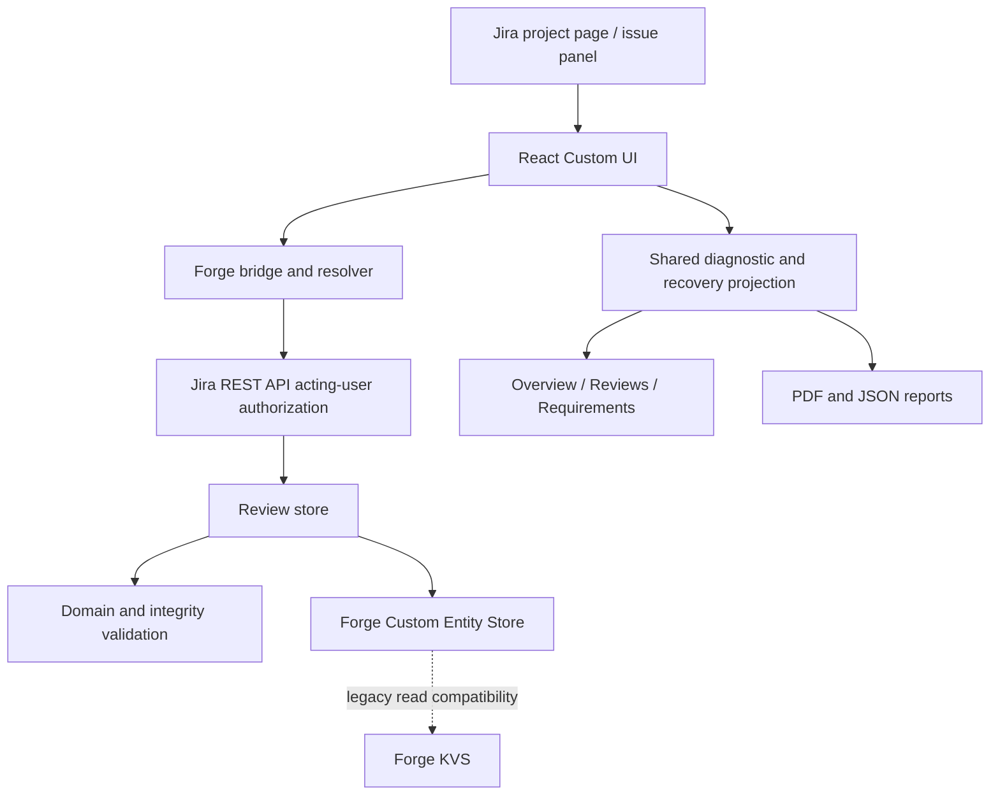

# ScopeProof — Evidence-aware delivery for Jira

**Atlassian Codegeist 2026 | Release candidate RC1 | 27 November 2026**

ScopeProof helps software teams understand whether a previously approved Jira issue is still supported by current evidence after its requirements change. Instead of treating approval as a permanent checkbox, ScopeProof connects each decision to the exact mandatory requirement versions and evidence records on which it was based.

When that basis changes, ScopeProof explains what invalidated the approval, identifies evidence that remains usable, and proposes the required recovery operations. A human must still make an explicit approval decision.

**Validated source:** [RC1 tag](https://github.com/topassky3/scopeproof/tree/scopeproof-codegeist-rc1) · [commit `82c55e6`](https://github.com/topassky3/scopeproof/commit/82c55e60fdfe1d762f0cff3ae7acd9ab2fc1c203) · [CI history](https://github.com/topassky3/scopeproof/actions)

## Why ScopeProof?

A Jira issue can change after its implementation or test evidence has been approved. A passing test for an old requirement version is not necessarily evidence for the new version. Rechecking every requirement may also be unnecessary when only part of the approved scope changed.

ScopeProof makes these distinctions explicit:

- **Versioned requirements:** mandatory and optional requirements are tracked separately.
- **Version-specific evidence:** the latest registered result for a requirement version determines its current evidence state; historical results remain visible.
- **Snapshot-based approval:** explicit decisions reference the requirement versions and evidence IDs that supported them.
- **Change impact:** changes to mandatory scope or evidence can invalidate a prior approval even when current coverage is complete.
- **Recovery planning:** the application identifies the evidence work that remains and the need for a new explicit approval.
- **Traceable reporting:** PDF and JSON exports describe the selected review revision, its records, and its diagnostic and recovery plan.

## Demonstration

The validated demonstration uses a synthetic Jira review with three mandatory requirements.

| Step | Expected state |
| --- | --- |
| Create three requirements and register current passing evidence | Coverage 3/3; ready for explicit approval |
| Approve the review | Approved |
| Publish a new version of one mandatory requirement | Coverage 2/3; revalidation required |
| Inspect the recovery plan | Renew the affected evidence; retain the two unaffected records |
| Register passing evidence for the new version | Coverage 3/3; revalidation still required |
| Explicitly approve again | Approved; previous evidence and decision remain in history |

This workflow was exercised on a Jira development installation in November 2026 (review ACD-2, final revision 10). All demonstration requirements and evidence are synthetic; registration of a passing result does not prove an external test was executed.

### Recovery model

For a fixed, nonempty mandatory scope of N requirements and a valid recovery scenario after a prior approval, let B be the number of mandatory requirements lacking current passing evidence. Assume each blocked requirement can be satisfied by one new passing evidence record, no further changes occur during recovery, and a new explicit approval is required.

Under these assumptions, the required number of operations is B + 1: one evidence registration for each blocked requirement, followed by one approval. A full re-evidence baseline requires N + 1 operations. The difference is N - B operations. The model is an operation-count comparison, not a measured reduction in human time or cost; it does not apply indiscriminately to rejected, malformed, empty or already approved reviews.

In the three-requirement demonstration, B = 1. The theoretical comparison is two operations instead of four (50% fewer equal-weight operations). Full evidence coverage alone does not restore approval.

## Architecture

ScopeProof is a Forge Custom UI application with a Jira project page and issue panel. Both use the same frontend and resolver.



| Component | Implementation |
| --- | --- |
| UI | React 18, TypeScript, Vite, feature-first components and shared CSS |
| Jira authorization | Acting-user issue access and `EDIT_ISSUES` checks before writes |
| Persistence | Forge Custom Entity Store (CES), per-issue conditional creation and revision-conditional transactions; legacy KVS read compatibility |
| Domain | Pure JavaScript rules for versions, evidence, decisions and audit history |
| Diagnosis | Change-impact analysis, integrity guards and shared revalidation planner |
| Exports | PDF via pdfmake and structured JSON, tied to the loaded review snapshot |
| Verification | Node test runner, TypeScript, Vite, Forge lint and GitHub Actions |

Key implementation paths: [`src/index.js`](src/index.js), [`src/domain.js`](src/domain.js), [`src/review-store.js`](src/review-store.js), [`src/ces-adapter.js`](src/ces-adapter.js), [`src/change-impact.js`](src/change-impact.js), [`src/revalidation-planner.js`](src/revalidation-planner.js), [`src/review-integrity.js`](src/review-integrity.js), [`src/shared/review-intelligence.js`](src/shared/review-intelligence.js).

The Django backend and standalone Next.js frontend are auxiliary repository components; they are not required for the Forge demonstration.

## Verification at RC1

The following records summarize the November 2026 acceptance of the tagged source.

| Check | Observed result |
| --- | --- |
| Clean dependency installation | `npm ci` succeeded |
| Core automated suite | 287 passed, 0 failed, 0 skipped |
| TypeScript and Vite | Build succeeded |
| Dependency audit | 0 vulnerabilities reported at the time of the check |
| Forge lint | No issues found |
| GitHub Actions | Five successful runs associated with the candidate commit, including core CI, Django and auxiliary Next.js checks |
| Jira development environment | Functional workflow, report exports, same-issue and cross-issue concurrent writes, and two-account authorization scenarios exercised |

Example CI evidence: [core CI on main](https://github.com/topassky3/scopeproof/actions/runs/46057838515), [Django checks](https://github.com/topassky3/scopeproof/actions/runs/46057838578), [Next.js checks on RC1](https://github.com/topassky3/scopeproof/actions/runs/46057838692).

These results describe specific tests and observed scenarios. They are not a comprehensive security certification, a production availability guarantee, or proof of arbitrary-scale performance.

## Reproduce the core checks

Use Git, npm and a compatible Node.js installation. RC1 was tested on Windows with Node.js 24.22.1 and npm 11.19.1.

```powershell
git clone https://github.com/topassky3/scopeproof.git
cd scopeproof
git checkout --detach scopeproof-codegeist-rc1
npm ci
npm run check
npm audit --audit-level=moderate
forge lint
```

`forge lint` requires the Forge CLI. Access to the repository and package registries is required. Dependency audit results may change over time as advisories are published.

For the local sample-data preview:

```powershell
npm run dev
```

Open `http://127.0.0.1:5173`. The browser preview uses sample data and local storage, not live Jira records; its multi-tab checks are not equivalent to the Forge storage transactions.

## Forge installation and judge access

The tagged manifest is associated with the existing ScopeProof Forge application. Authorized maintainers can build and deploy it using the Forge CLI; deployment and installation are deliberate operations, not required for local tests.

Do not run `forge register` against the existing application unless intentionally creating a separate app identity. Changing the app identity changes its installation and storage association. Never commit credentials or private Jira records.

The judge installation or distribution link and final demonstration video are submission deliverables. The development project link is not a substitute for a verified judge installation link.

## Navigation

| Screen | Purpose |
| --- | --- |
| Overview | Project review status and selected issue recovery plan |
| Reviews | Browse and inspect review status and decisions |
| Requirements | Manage requirement versions and mandatory scope |
| Evidence | Record results against explicit requirement versions |
| History | Inspect requirement, evidence and decision events |
| Reports | Export PDF and JSON snapshots |
| Settings | Read-only explanation of current policy and limitations |

## Known limitations and deployment boundaries

- Any acting user with Jira `EDIT_ISSUES` may perform review writes, including approval; separate reviewer roles and multi-reviewer workflows are not implemented.
- Evidence records and URLs are user-supplied references. ScopeProof does not independently execute tests or authenticate their external results.
- Historical events are retained by application rules, but the audit history is not a cryptographically signed or independently immutable ledger.
- The server authorizes issue access before storage reads and checks edit permissions before commands. Two-account tests exercised these boundaries; they do not exhaust every permission configuration or threat scenario.
- A previously loaded review can remain stale until explicitly refreshed. Reports represent the loaded revision, not a live certificate. A stale view was observed during acceptance and its exact cause was not established.
- The project index is eventually consistent and the current project view is bounded to 40 candidate issue keys. Direct reads are authorized and validated separately.
- The storage adapter enforces a 220 KiB serialized review-record budget. Large in-memory benchmarks must not be interpreted as supported deployed review sizes.
- Concurrent conditional writes and unknown commit outcomes are handled by revision guards and exact receipt checks; reload before retrying an uncertain save. No automatic write retry is performed.
- Issue moves or rekeys may require inspection; automatic migration for such changes is not part of RC1.
- Automatic detection of arbitrary Jira description changes, notifications, external CI evidence verification and production observability are outside the validated scope.
- The acceptance log includes dependency deprecation/install-script warnings and large PDF-related chunks. These were not build failures; they remain documented engineering considerations.
- Review exports for sensitive information before sharing. Do not include actual private issue data in a public demonstration.

## Documentation and submission

The existing `docs/` directory includes architecture notes, UI designs, standalone integration notes and historical acceptance records. Some documents describe earlier development milestones; the RC1 tag and this summary identify the validated candidate. UI design images are reference designs, not necessarily screenshots of the deployed application.

Official contest rules: https://codegeist2026.devpost.com/rules. Verify current eligibility, distribution, installation and video requirements before final submission.
