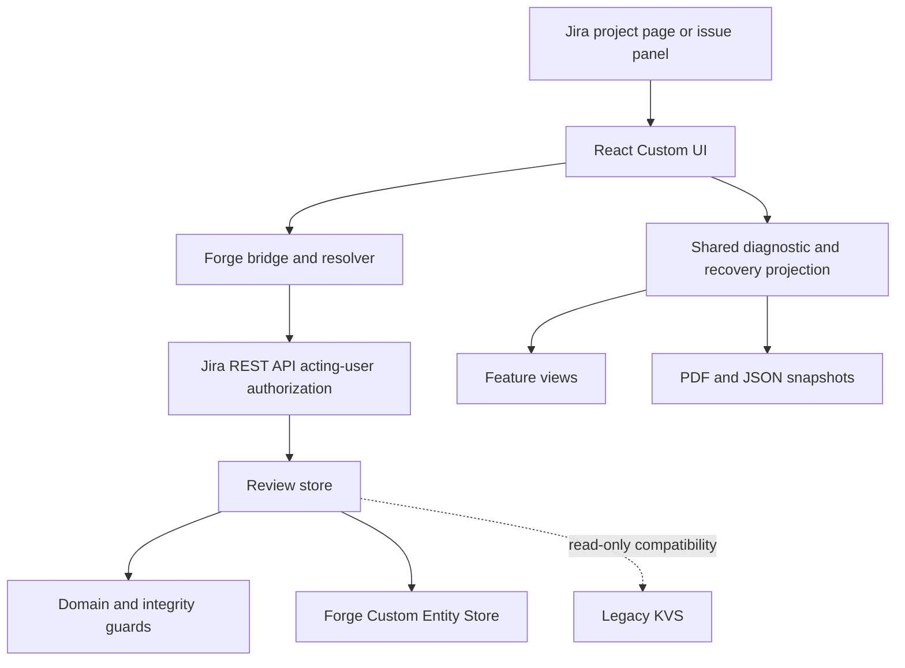

# ScopeProof — RC1 architecture and engineering boundaries

Validated source: [`scopeproof-codegeist-rc1`](https://github.com/topassky3/scopeproof/tree/scopeproof-codegeist-rc1), commit `82c55e60fdfe1d762f0cff3ae7acd9ab2fc1c203` (27 November 2026).

This document describes the Forge application in RC1, not a proposed production architecture or a security certification. The standalone Django and Next.js components are auxiliary and are not dependencies of the Forge demonstration.

## 1. Runtime boundaries

Both Jira modules use the same frontend bundle and resolver. The Forge manifest declares `read:jira-work`, `read:jira-user` and `storage:app`, and uses the Node.js 24 runtime on ARM64. Review records are application data, not modifications to Jira issues.

| Layer | Responsibility | Source |
| --- | --- | --- |
| Jira authorization | Resolve issue identity and enforce acting-user access before review operations | [`src/index.js`](../src/index.js) |
| Storage adapter | Conditional CES operations and legacy reads | [`src/ces-adapter.js`](../src/ces-adapter.js) |
| Review store | Load, validate, mutate and persist a review; verify uncertain receipts | [`src/review-store.js`](../src/review-store.js) |
| Domain | Versioned requirements, evidence, approval and audit transitions | [`src/domain.js`](../src/domain.js) |
| Integrity | Reject ambiguous or inconsistent records at use boundaries | [`src/review-integrity.js`](../src/review-integrity.js), [`src/review-read.js`](../src/review-read.js) |
| Intelligence | Derive causes, retained evidence and recovery actions | [`src/change-impact.js`](../src/change-impact.js), [`src/revalidation-planner.js`](../src/revalidation-planner.js), [`src/shared/review-intelligence.js`](../src/shared/review-intelligence.js) |
| Presentation | Feature-first screens and shared UI | [`src/app/`](../src/app/), [`src/features/`](../src/features/), [`src/shared/`](../src/shared/) |
| Reports | Structured snapshot exports with integrity and provenance checks | [`src/features/reports/`](../src/features/reports/) |

## 2. Authorization and identity

- `getReview` resolves a Jira issue through `api.asUser().requestJira()` before reading app storage. The authenticated response supplies the issue ID, project ID and canonical issue key.
- `command` requires an authenticated account, issue access and Jira `EDIT_ISSUES` before mutation. No separate approver role exists in RC1.
- `listReviews` checks access to the requested project and then authorizes each candidate issue individually. A candidate is not evidence of access. The issue must belong to the requested project.
- Inaccessible and missing issues can both produce `ISSUE_NOT_ACCESSIBLE`; the error is deliberately not an existence oracle.
- Direct issue lookup can access an authorized issue in another project. It does not impose a project restriction beyond Jira authorization. The project list remains project-scoped.
- The authenticated Jira identity is used for storage and attribution rather than an arbitrary client-supplied database key.

## 3. Domain and recovery model

Requirements have monotonically increasing versions. Evidence is associated with a particular requirement version. The latest registered result for that version determines current coverage; earlier results retain their historical meaning.

An approval captures the mandatory requirement versions and evidence identifiers that supported the decision. A changed mandatory scope, version or superseding evidence may invalidate the snapshot. Current passing evidence for every mandatory requirement is necessary for approval; a human decision is still required.

The diagnostic distinguishes invalidated decisions, missing or failed evidence, historical evidence, and evidence retained for current coverage. The planner provides advisory recovery operations. Empty, rejected or inconsistent cases are handled separately rather than forced into a numerical recovery claim.

For a fixed nonempty mandatory scope of N requirements, B blocked requirements, a valid revalidation scenario, one new passing record per blocked requirement, no further changes and one required explicit approval, the operation-count model is B + 1 versus N + 1 for full re-evidence. These are equal-weight operations, not observed labor or cost savings. The planned work is not an automatically executed workflow.

## 4. Persistence and concurrency

CES entity: `scopeproof-review`. The record key is `review:<authenticated Jira issue ID>`. Its wrapper stores the project ID, issue key, string revision, unique write token and serialized review.

- CES is authoritative when a record exists. Legacy KVS is a read fallback when CES is absent. A malformed CES record is not silently replaced with legacy data.
- First writes use `FAIL_IF_EXISTS`. Subsequent writes use a CES transaction with an equality condition on the prior revision. Domain commands also require the expected review revision.
- On an uncertain write outcome, the store reads the exact record back. Only a matching unique token and equal canonical record confirm that write. Otherwise it returns `COMMIT_OUTCOME_UNKNOWN` and requires a reload before retrying. There is no automatic write retry.
- This protects the tested per-issue conditional write cases; it is not a general guarantee for every failure or distributed workflow.
- The `by-project-issue` index discovers candidates using project ID and issue key. The store merges CES results with legacy index candidates, deduplicates, and limits the view to 40 candidate keys. Index reads may lag; direct authorized reads establish the record used by the selected review.
- The serialized review wrapper is limited to 220 KiB by the application. The large in-memory engine benchmarks do not establish a deployed capacity at that scale.
- Issue moves/rekeys may require inspection; automated migration for those changes is outside RC1.

## 5. UI and report boundaries

The browser loads a selected review revision and derives the diagnostic from the shared rules. The editor captures its issue, revision and requirement target; evidence creation requires an explicit valid target. Integrity checks suppress unsafe projections and commands.

Reports are snapshots of the loaded revision. The JSON and PDF consumers share the diagnostic semantics, and publication guards reject inconsistent or mismatched projections. This is application-level provenance checking, not cryptographic signing. The app does not certify external evidence or independently verify a URL's contents.

A previously loaded review can remain stale until explicitly reopened. This occurred during acceptance; its exact cause was not determined. A successful authorized reload recovered the current revision in the tested scenario.

The local Vite preview uses browser storage and synthetic data. It is deliberately separate from Jira; local multi-tab checks are not equivalent to Forge CES transactions.

## 6. Validation and remaining limitations

RC1 passed a clean install, 287 core automated tests, TypeScript/Vite build, npm dependency audit (zero vulnerabilities reported at that check), and Forge lint. Five CI runs associated with the candidate commit completed successfully, including Django and Next.js checks. Jira development tests exercised approval/revalidation, reporting, concurrent writes and two-account access boundaries.

Remaining limits include separate reviewer roles, multi-reviewer policy, independently immutable audit logs, comprehensive security testing, externally verified evidence, arbitrary Jira-change detection, notifications, production observability and distribution validation. The private-resource test demonstrated access denial for the tested second account; documentary confirmation of the space permission configuration remains outstanding. The audit and performance results are scoped to the recorded tests.

See the [RC1 README](../README.md) for reproduction commands and the [delivery roadmap](ROADMAP.md) for submission work.
